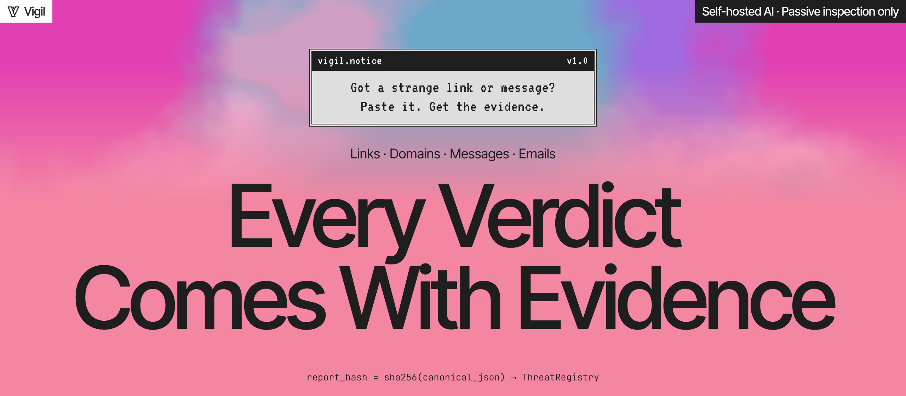
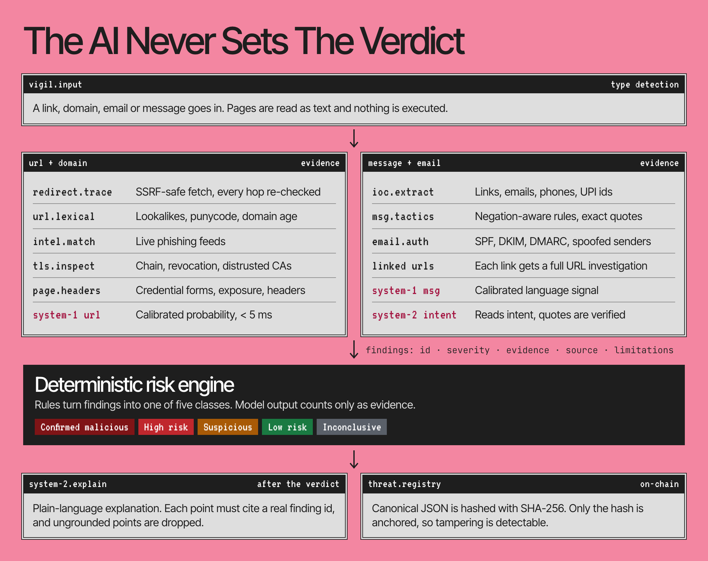
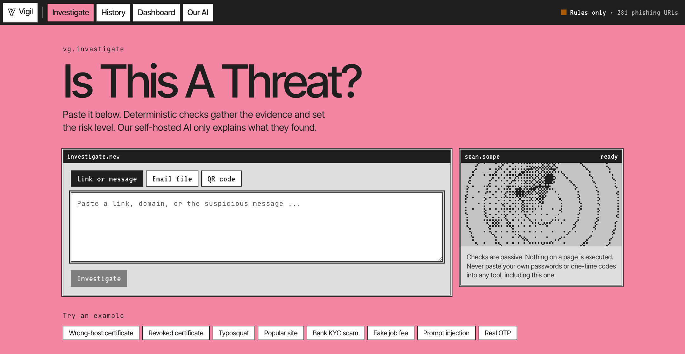
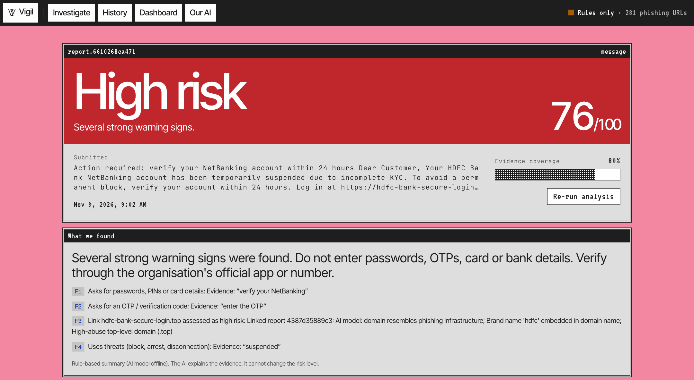
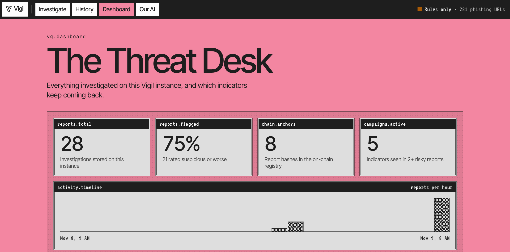
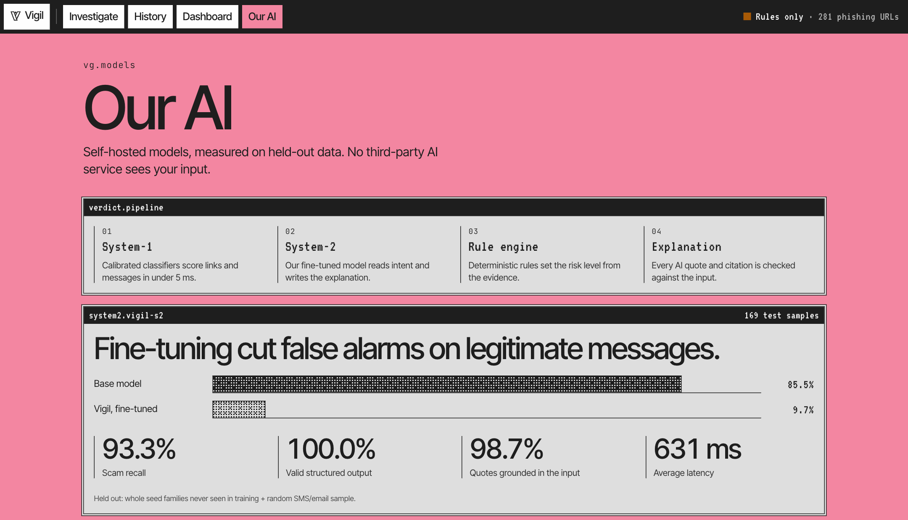

<div align="center">



<br>

**AI-powered web threat detection and digital trust intelligence.**<br>
Paste a suspicious link, domain, email or message. Get an evidence-backed risk report anyone can read.

<br>


[](https://sepolia.etherscan.io/address/0x012175dc68cb5480e37419a2ec9e04ee5Eef216F)
[](docs/TESTING.md)

**[How it works](#how-it-works)** ·
**[Screens](#screens)** ·
**[Our AI](#our-ai)** ·
**[Quick start](#quick-start)** ·
**[Docs](#docs)** ·
**[References](#references)**

</div>

<br>

`vg.overview`

## Why Vigil

Ask a language model whether a message is a scam and you get an opinion. Its answer can shift with the wording, the
message itself can talk it out of that answer, and it cannot show you what it actually checked.

Vigil separates the jobs:

| | |
|---|---|
| **Checks decide** | Passive checks collect evidence, and a deterministic rule engine turns it into a risk level. Model output counts only as evidence, so the AI cannot overrule the engine. |
| **AI explains** | `vigil-s2`, our self-hosted model, turns findings into plain language. Every quote and citation it produces is verified against the input. |
| **Limits are listed** | Checks that could not run appear on the report. When the evidence runs out, the verdict is *Inconclusive*, not a confident guess. |
| **Reports are tamper-evident** | A report's SHA-256 hash can be anchored on-chain. Only the hash goes on-chain, never the content. |

No user data ever leaves our infrastructure for an AI provider. Inspection is passive: no exploitation, no active
scanning, no JavaScript execution and no downloads.

<br>

`vg.pipeline`

## How it works



The risk engine assigns one of five classes:

| Class | When |
|---|---|
|  | An authoritative threat-intel match, or a message containing such a link |
|  | A critical finding, two or more high findings, a high finding with model probability ≥ 0.7, or score ≥ 60. For messages: a confirmed harmful request combined with manipulation tactics |
|  | One significant indicator, or scam-like language without a harmful request |
|  | Nothing significant in the completed checks |
|  | Fewer than half the checks completed and no indicators |

The full pipeline, rules and platform threat model are in [docs/ARCHITECTURE.md](docs/ARCHITECTURE.md).

<br>

`vg.screens`

## Screens

<table>
  <tr>
    <td width="50%"></td>
    <td width="50%"></td>
  </tr>
  <tr>
    <td><b>Investigate.</b> Paste a link or message, or upload an email file or QR code.</td>
    <td><b>Report.</b> A verdict, its score and evidence coverage, with each finding cited.</td>
  </tr>
  <tr>
    <td></td>
    <td></td>
  </tr>
  <tr>
    <td><b>The Threat Desk.</b> Activity, risk mix and indicators that keep coming back.</td>
    <td><b>Our AI.</b> Live evaluation numbers, served from the model metrics.</td>
  </tr>
</table>

<sub>Captured from a local instance using demo inputs, with System-2 offline. That is why the status bar reads "Rules only" and the report shows the rule-based fallback summary.</sub>

<br>

`vg.models`

## Our AI

Instead of calling a third-party LLM, Vigil runs a self-hosted **System-1 / System-2 hybrid**.

| | System-1 | System-2 |
|---|---|---|
| **What** | Calibrated classifiers we trained: `host-v2` for URLs and `msg-v1` for messages | `vigil-s2`: Qwen3-1.7B (4-bit) fine-tuned with LoRA on MLX, distilled from a local teacher |
| **Job** | Fast calibrated signals on every request, and routing confidently benign messages past System-2 | Reads intent ("do **not** share your OTP" vs "share the OTP") and writes explanations that must cite evidence |
| **Speed** | < 5 ms on CPU | 631 ms average in evaluation |
| **Size** | ~10 MB | ~1 GB |

Fine-tuning cut false alarms on legitimate messages from **85.5% to 9.7%** on a held-out test set of 169 messages,
including whole scam families never seen in training.

| Measure | Result |
|---|---|
| `vigil-s2` scam recall | **93.3%** |
| `vigil-s2` legitimate false positives (base model: 85.5%) | **9.7%** |
| `vigil-s2` evidence quotes grounded in the input | **98.7%** |
| `vigil-s2` valid structured output | **100%** |
| Full hybrid scam recall / legitimate false positives | **95.5%** / **11.3%** |
| `host-v2` live OpenPhish URLs detected (out-of-time, n=227) | **86.3%** |
| `host-v2` false positives on real legitimate subdomains (n=40) | **2.5%** |
| `host-v2` expected calibration error | **0.008** |
| `msg-v1` held-out SMS/email F1 (n=4,378) | **0.9734** |

The [model card](docs/MODEL_CARD.md) has the complete evaluation, known limitations and a round-2 fine-tune we measured
and chose not to deploy because it missed real scams.

<br>

`vg.quickstart`

## Quick start

Needs Python 3.13 and Node 24. Run each long-lived command in its own terminal.

```bash
# 1. Install
python3.13 -m venv .venv && .venv/bin/pip install -r backend/requirements.txt
(cd contracts && npm install) && (cd frontend && npm install)
cp .env.example .env && cp frontend/.env.example frontend/.env.local

# 2. Local chain: start it, then deploy from a second terminal
(cd contracts && npm run node)
(cd contracts && npm run deploy:local)   # put the printed address in .env and frontend/.env.local

# 3. API on :8000 (docs at http://localhost:8000/docs)
scripts/run_api.sh

# 4. Landing page on http://localhost:3100, the app at /investigate
(cd frontend && npm run build && npm run start -- -p 3100)
```

Reports go to Postgres when `DATABASE_URL` is set in `.env`, otherwise to a local SQLite file. Accounts use Clerk: put
`CLERK_PUBLISHABLE_KEY` in `.env` and the Clerk keys in `frontend/.env.local`. Without an account you can still run
investigations, but History and the Dashboard need sign-in.

A Hardhat node keeps its chain in memory: after restarting it, run `deploy:local` again. Reports anchored earlier show
as not anchored and can be registered again.

<details>
<summary><b>Optional: the self-hosted System-2 model</b></summary>

<br>

Without it the backend falls back to a local Ollama model, then to templates, and the risk level is unaffected.

```bash
.venv/bin/pip install mlx-lm    # Apple Silicon only
scripts/serve_s2.sh             # serves on :8090; needs ml/models/qwen3-1.7b-4bit (not in the repo)
```

</details>

<details>
<summary><b>Deploy to Sepolia</b></summary>

<br>

Use a dedicated wallet holding only test ETH. In `.env`, set `SEPOLIA_RPC_URL` and `SEPOLIA_PRIVATE_KEY`, then run
`(cd contracts && npm run deploy:sepolia)`. Point `CHAIN_RPC_URL`, `CHAIN_PRIVATE_KEY`, `CHAIN_CONTRACT_ADDRESS` and
`CHAIN_DEPLOY_BLOCK` at that deployment, set `NEXT_PUBLIC_RPC_URL` (a public RPC, because it ships to the browser) and
`NEXT_PUBLIC_CONTRACT_ADDRESS` in `frontend/.env.local`, and rebuild the frontend.

The current `ThreatRegistry` deployment is
[`0x012175dc…f216F`](https://sepolia.etherscan.io/address/0x012175dc68cb5480e37419a2ec9e04ee5Eef216F) on Sepolia.

</details>

<details>
<summary><b>Run the tests</b></summary>

<br>

```bash
.venv/bin/pip install pytest && .venv/bin/python -m pytest tests   # backend
(cd contracts && npm test)                                         # contract
.venv/bin/python tests/run_cases.py                                # end-to-end cases → docs/TESTING.md
```

</details>

<details>
<summary><b>Try the tamper demo</b></summary>

<br>

Register a report on-chain from its report page, then:

```bash
.venv/bin/python scripts/tamper_report.py <report_id>             # changes the verdict and rewrites the stored hash
.venv/bin/python scripts/tamper_report.py <report_id> --restore   # puts it back
```

Click **Verify against chain** after each step.

</details>

<details>
<summary><b>Reproduce the models</b></summary>

<br>

```bash
# data (public): PhiUSIIL (UCI), Tranco top-1M, OpenPhish feed, UCI SMS Spam, phishing-email corpus → ml/data/
.venv/bin/python ml/train_url.py          # System-1 URL model  → backend/app/ml/artifacts/url_model.joblib
.venv/bin/python ml/train_msg.py          # System-1 msg model  → msg_model.joblib
.venv/bin/python ml/build_distill.py --emails 600   # local teacher labels (Ollama qwen3:4b-instruct)
.venv/bin/python ml/collect_reports.py && .venv/bin/python ml/build_explain.py
.venv/bin/python ml/build_s2_sets.py && scripts/train_s2.sh   # LoRA fine-tune (MLX)
.venv/bin/python ml/eval_s2.py            # base vs fine-tuned vs teacher vs System-1 → s2_metrics.json
```

</details>

<br>

`vg.docs`

## Docs

| Document | What it covers |
|---|---|
| [API.md](docs/API.md) | API contract for the frontend and Web3 integration, including report hash format and verification |
| [ARCHITECTURE.md](docs/ARCHITECTURE.md) | Architecture, analysis pipeline, threat-intel sources and security methodology |
| [MODEL_CARD.md](docs/MODEL_CARD.md) | Training data, evaluation results and limitations for each model |
| [TESTING.md](docs/TESTING.md) | Test cases with observed results and model evaluation |
| [DEMO.md](docs/DEMO.md) | A five-minute live demo script |

Sample reports: [phishing URL](docs/sample_report_phishing_url.json) ·
[scam message](docs/sample_report_scam_message.json) · [TLS issue](docs/sample_report_tls_issue.json) ·
[legitimate OTP](docs/sample_report_legit_otp.json) · [benign URL](docs/sample_report_benign_url.json)

### Repository layout

```
backend/app/
  main.py            FastAPI endpoints          pipeline.py   investigation orchestration
  risk.py            deterministic risk engine  store.py      reports, hashing, correlation index
  checks/            fetcher (SSRF-safe) · domain · tls · page/headers · threatintel · message rules
  chain.py           on-chain anchoring, verification and domain lookup
  ml/                System-1 models · System-2 client · prompts · artifacts/ (models + metrics)
contracts/           ThreatRegistry.sol · Hardhat tests · deploy script
frontend/            Next.js UI: investigate · report · history · dashboard · our AI
ml/                  datasets, teacher, distillation, training & evaluation scripts
scripts/             train_s2.sh · serve_s2.sh · run_api.sh · tamper_report.py
tests/run_cases.py   end-to-end test suite
```

<br>

`vg.references`

## References

**Datasets and threat intelligence**

1. Prasad, A., & Chandra, S. (2024). PhiUSIIL: A diverse security profile empowered phishing URL detection framework
   based on similarity index and incremental learning. *Computers & Security*, 136.
   [DOI](https://doi.org/10.1016/j.cose.2023.103545) · [UCI dataset](https://archive.ics.uci.edu/dataset/967/phiusiil+phishing+url+dataset)
2. Le Pochat, V., et al. (2019). Tranco: A research-oriented top sites ranking hardened against manipulation. *NDSS*.
   [DOI](https://doi.org/10.14722/ndss.2019.23386) · [tranco-list.eu](https://tranco-list.eu/)
3. Almeida, T. A., & Gómez Hidalgo, J. M. (2011). [SMS Spam Collection](https://archive.ics.uci.edu/dataset/228/sms+spam+collection). UCI Machine Learning Repository.
4. [OpenPhish](https://openphish.com/) phishing feed, with optional [URLhaus](https://urlhaus.abuse.ch/) and
   [Google Safe Browsing](https://developers.google.com/safe-browsing) lookups.
5. [crt.sh](https://crt.sh/) Certificate Transparency search, and [badssl.com](https://badssl.com/) test hosts.

**Models and methods**

6. Yang, A., et al. (2025). [Qwen3 Technical Report](https://arxiv.org/abs/2505.09388). arXiv:2505.09388.
7. Hu, E. J., et al. (2021). [LoRA: Low-Rank Adaptation of Large Language Models](https://arxiv.org/abs/2106.09685). arXiv:2106.09685.
8. Hinton, G., Vinyals, O., & Dean, J. (2015). [Distilling the Knowledge in a Neural Network](https://arxiv.org/abs/1503.02531). arXiv:1503.02531.
9. Zadrozny, B., & Elkan, C. (2002). Transforming classifier scores into accurate multiclass probability estimates.
   *KDD*. [DOI](https://doi.org/10.1145/775047.775151)
10. Platt scaling and isotonic regression: [scikit-learn probability calibration guide](https://scikit-learn.org/stable/modules/calibration.html).

**Standards and security guidance**

11. Certificates and transparency: [RFC 5280](https://www.rfc-editor.org/rfc/rfc5280) (X.509) ·
    [RFC 6960](https://www.rfc-editor.org/rfc/rfc6960) (OCSP) · [RFC 6962](https://www.rfc-editor.org/rfc/rfc6962) (Certificate Transparency)
12. Email authentication: [RFC 7208](https://www.rfc-editor.org/rfc/rfc7208) (SPF) ·
    [RFC 6376](https://www.rfc-editor.org/rfc/rfc6376) (DKIM) · [RFC 7489](https://www.rfc-editor.org/rfc/rfc7489) (DMARC)
13. Domain registration data: [RFC 9083](https://www.rfc-editor.org/rfc/rfc9083) (RDAP)
14. OWASP [SSRF Prevention Cheat Sheet](https://cheatsheetseries.owasp.org/cheatsheets/Server_Side_Request_Forgery_Prevention_Cheat_Sheet.html) ·
    OWASP [LLM01: Prompt Injection](https://genai.owasp.org/llmrisk/llm01-prompt-injection/)

**Built with**

[Next.js](https://nextjs.org/) · [FastAPI](https://fastapi.tiangolo.com/) · [scikit-learn](https://scikit-learn.org/) ·
[MLX](https://github.com/ml-explore/mlx) · [mlx-lm](https://github.com/ml-explore/mlx-lm) · [Ollama](https://ollama.com/) ·
[Hardhat](https://hardhat.org/) · [ethers](https://docs.ethers.org/v6/)

<br>


